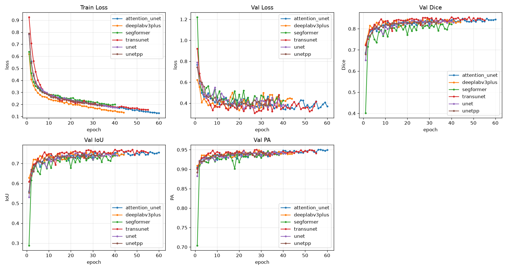

# seg-compare

4 个经典 CNN（UNet / UNet++ / Attention UNet / DeepLabV3+）在 ISIC 2017 Task 1 上，用**同一套数据、同一个训练循环**做横向对比；后续将加入 TransUNet、SegFormer 做 CNN 与 Transformer 的对照。

> 项目目标是吃透架构差异，不对标论文精度；所有图统一 resize 到 256×256。

## 复现三步

1. 装环境：`pip install -r requirements.txt`（torch 版本先按 `nvidia-smi` 的 CUDA Version 去 pytorch.org 选对应 wheel）
2. 放数据：把 ISIC 2017 **Task 1** 的 `Training Data` + `Training Ground Truth` 解压到 `data/raw/`，跑 `python scripts/prepare_data.py` 生成 `data/processed/` 和 `data/splits/train_val_test.json`
3. 训练与评估：`python engine/train.py --cfg configs/unet.yaml` → `python engine/evaluator.py --cfg configs/unet.yaml`；全部跑完后 `python scripts/make_figures.py` → `python scripts/make_table.py`

## 结果总表

测试集 600 张，同一套数据划分 / 训练循环 / 指标；数字由 `scripts/make_table.py` 从 `results/logs/*.json` 自动汇总。

| Model | Params(M) | Val Best Dice | Test Dice | Test IoU | Test PA |
|---|---|---|---|---|---|
| DeepLabV3+ | 10.12 | 0.8473 | 0.8451 | 0.7590 | 0.9330 |
| UNet++ | 34.92 | 0.8397 | 0.8290 | 0.7389 | 0.9221 |
| Attention UNet | 31.40 | 0.8481 | 0.8274 | 0.7390 | 0.9252 |
| UNet | 31.04 | 0.8397 | 0.8168 | 0.7259 | 0.9212 |

> 局限：单 seed、从头训练、256 分辨率、早停；模型间差距 1~3 个点属同量级，不对标论文精度。

## 封面图

各模型测试集预测叠加图见 `results/preds/<模型>/overlay.png`。

## 目录速览

configs/  全局 base.yaml + 每个模型一份专属超参
models/   4 个网络 + build_model 工厂
engine/   训练循环 / 损失 / 指标 / 统一评估
results/  logs / curves / preds / figures（入库，是结论证据）
scripts/  从 logs 一键出图、出表
notes/    流程复盘与结构对比笔记
tests/    test_shapes.py，CI 里跑

## Project Structure
seg-compare/
├── README.md                # 项目简介、复现流程、实验结果总表、封面图
├── requirements.txt         # 依赖锁定
├── .gitignore               # 屏蔽数据集、权重、运行缓存
├── configs/
│   ├── base.yaml            # 全局公共配置：seed、image_size、batch_size、epoch、lr、data split
│   ├── unet.yaml
│   ├── unetpp.yaml
│   ├── attention_unet.yaml
│   └── deeplabv3plus.yaml
├── data/
│   ├── raw/                 # ISIC2017 原始压缩解压数据，不上传 git
│   ├── processed/           # 统一 resize 到 256×256 的图像，不上传 git
│   ├── splits/train_val_test.json  # 固定划分文件，所有模型共用（必须入库）
│   └── dataset.py           # Dataset、数据增强
├── models/
│   ├── blocks.py            # 共享基础模块：ConvBNReLU, Down, Up
│   ├── unet.py
│   ├── unetplusplus.py
│   ├── attention_unet.py
│   ├── deeplabv3plus.py
│   └── __init__.py          # build_model 模型工厂
├── engine/
│   ├── train.py             # 统一训练循环，所有模型共用
│   ├── losses.py            # CE / Dice / BCE+Dice
│   ├── metrics.py           # Dice、IoU、PA（像素准确率）
│   └── evaluator.py         # 统一测试评估，输出 json 日志
├── results/
│   ├── logs/*.json          # 每个实验的指标日志
│   ├── curves/              # loss、验证 Dice 曲线
│   ├── preds/               # test 集预测可视化图
│   └── figures/             # 最终对比图（README 封面）
├── scripts/
│   ├── make_figures.py      # 从日志自动绘制曲线、对比图
│   └── make_table.py        # 自动生成 README 的结果汇总表格
├── notes/
│   └── project_flow.md      # 全流程复盘（项目顺序）
├── tests/
│   └── test_shapes.py       # 单元测试：校验模型输入输出维度
└── .github/workflows/ci.yml # CI 自动运行维度测试